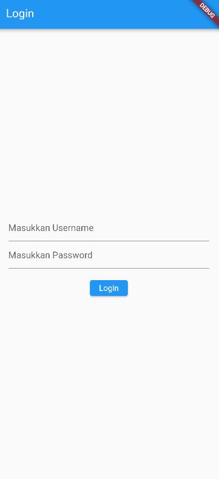
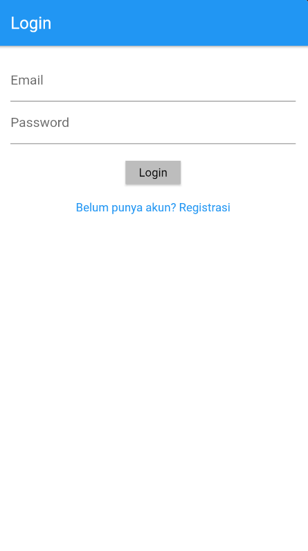
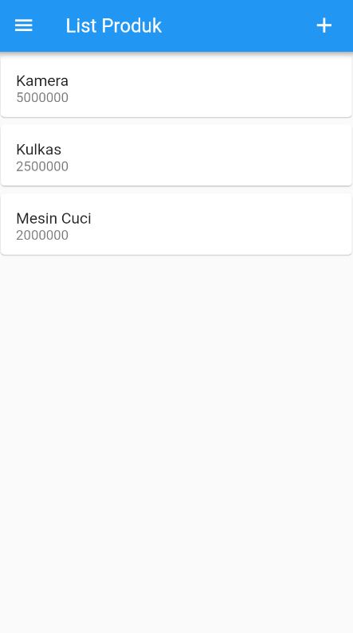
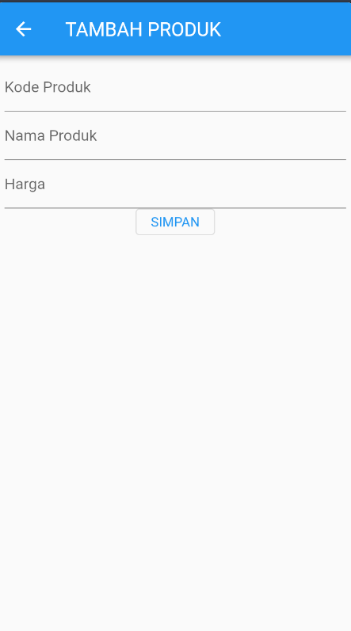

# Praktikum Pemrograman Mobile

Repositori ini berisi kumpulan materi, latihan, dan tugas praktikum mata kuliah Pemrograman Mobile.

---

## 📌 Pertemuan 1: Implementasi Queue Sederhana di Dart

Pada modul ini dilakukan implementasi struktur data **Queue (Antrean)** sederhana menggunakan bahasa pemrograman Dart dengan prinsip **FIFO (First In, First Out)**.

### ⚙️ Penjelasan Fungsi
- `enqueue(T element)`: Menambahkan elemen ke urutan paling belakang antrean (`_items.add(element)`) dan menampilkan notifikasi data berhasil masuk.
- `dequeue()`: Mengambil dan menghapus elemen dari urutan paling depan (`_items.removeAt(0)`) dan menampilkan notifikasi data terdepan telah dihapus.
- `display()`: Mencetak isi elemen antrean saat ini dalam format list `[ ... ]`.
- `isEmpty`: Getter boolean untuk memeriksa apakah antrean sedang kosong atau tidak.

### 📤 Output Program (6 Baris)
```plaintext
10 berhasil ditambahkan ke antrian
20 berhasil ditambahkan ke antrian
30 berhasil ditambahkan ke antrian
isi antrian [10, 20, 30]
10 dihapus dari antrian
isi antrian [20, 30]
```

### 🚀 Cara Menjalankan Pertemuan 1
Buka terminal lalu jalankan perintah:
```bash
dart run queue.dart
```

---

## 📌 Pertemuan 2: Praktikum Pemrograman Mobile - Dasar Widget Flutter

Proyek ini berisi implementasi materi praktikum dasar pengembangan aplikasi mobile menggunakan framework Flutter. Materi mencakup pengenalan widget dasar, tata letak (*layout*), pembuatan formulir input, hingga pemanfaatan daftar berulang (*ListView*).

### 🚀 Fitur & Halaman Pertemuan 2
- **Hello World (`hello_world.dart`)**: Pengenalan widget `Scaffold`, `AppBar`, `Center`, dan `Text`.
- **Column Widget (`column_widget.dart`)**: Penyusunan elemen antarmuka secara vertikal.
- **Row Widget (`row_widget.dart`)**: Penyusunan elemen antarmuka secara horizontal.
- **Form Produk & Detail (`ui/produk_form.dart` & `ui/produk_detail.dart`)**:
  - Input data produk (Kode, Nama, dan Harga).
  - Pengiriman data antarhalaman (*Navigation & Routing*).
- **List Data Produk (`ui/produk_page.dart`)**: Menampilkan daftar barang menggunakan kombinasi `ListView` dan `Card`.

---

## 📌 Pertemuan 3: Routes, Side Menu, Login dan Local Storage

Pada modul ini dilakukan praktikum pembuatan halaman autentikasi Login, penggunaan Local Storage menggunakan `shared_preferences` untuk menyimpan sesi pengguna, serta pembuatan Side Menu (*Drawer*) untuk navigasi antarhalaman.

### 🚀 Fitur & Halaman Pertemuan 3
- **Halaman Login (`login_page.dart`)**: Form autentikasi username dan password, serta menyimpan username pengguna ke local storage via `shared_preferences`.
- **Halaman Utama (`home_page.dart`)**: Menampilkan pesan selamat datang yang dipersonalisasi sesuai username yang tersimpan di local storage.
- **Side Menu / Drawer (`sidemenu.dart`)**: Navigasi bilah samping untuk berpindah antara halaman Home dan About.
- **Halaman About (`about_page.dart`)**: Halaman statis informasi yang terhubung melalui side menu.

## 🛠️ Struktur Folder Proyek

```plaintext
lib/
├── main.dart
├── hello_world.dart
├── column_widget.dart
├── row_widget.dart
├── login_page.dart
├── home_page.dart
├── sidemenu.dart
├── about_page.dart
└── ui/
    ├── produk_form.dart
    ├── produk_detail.dart
    └── produk_page.dart
```

---

## 💻 Cara Menjalankan Proyek Flutter (Pertemuan 2 & 3)

1. Pastikan dependensi terpasang (termasuk `shared_preferences` untuk Pertemuan 3):
   ```bash
   flutter pub get
   ```

2. Jalankan aplikasi melalui browser (Edge/Chrome) atau emulator:
   ```bash
   flutter run -d edge
   ```
### 📸 Tampilan Aplikasi Pertemuan 3

#### 1. Halaman Login


#### 2. Halaman Home (User Logged In)


---

## 📌 Pertemuan 4: Integrasi REST API (Registrasi, Login, dan Katalog Produk)

Pada modul ini dilakukan integrasi aplikasi Flutter dengan REST API backend (CodeIgniter 4) untuk proses autentikasi (Registrasi & Login), penanganan Token Bearer (JWT) yang disimpan di local storage via `shared_preferences`, serta pengambilan data katalog produk secara asinkron menggunakan package `http`.

### 🚀 Fitur & Komponen Pertemuan 4
- **Helper & Layanan API (`lib/helpers/` & `lib/service/`)**:
  - `api.dart`: Helper HTTP client untuk method `GET`, `POST`, dan `DELETE` lengkap dengan handling exception (`app_exception.dart`) dan injeksi Authorization Bearer token.
  - `api_url.dart`: Konfigurasi endpoint REST API backend.
  - `user_info.dart`: Manajemen sesi autentikasi (penyimpanan token, user ID, dan fungsi logout) menggunakan `shared_preferences`.
  - `login_service.dart`, `registrasi_service.dart`, `produk_service.dart`: Layanan untuk komunikasi data API dengan parsing model.
- **Model Data (`lib/model/`)**:
  - `login.dart`: Representasi data respons login (token, userID, userEmail).
  - `registrasi.dart`: Representasi data respons registrasi pengguna baru.
  - `produk.dart`: Representasi data produk (id, kode produk, nama produk, harga produk).
- **Antarmuka Pengguna (`lib/ui/`)**:
  - `registrasi_page.dart`: Form registrasi pengguna baru dengan validasi form dan feedback dialog.
  - `login_page.dart`: Form login yang memvalidasi user, menyimpan token, dan mengarahkan ke katalog produk.
  - `produk_page.dart`: Menampilkan daftar produk dari REST API menggunakan `FutureBuilder` & `ListView`, serta tombol Logout pada AppBar.
  - `produk_form.dart` & `produk_detail.dart`: Form pembuatan/detail informasi produk.

### 🛠️ Struktur Folder Proyek (Terbaru)

```plaintext
lib/
├── helpers/
│   ├── api.dart
│   ├── api_url.dart
│   ├── app_exception.dart
│   └── user_info.dart
├── model/
│   ├── login.dart
│   ├── produk.dart
│   └── registrasi.dart
├── service/
│   ├── login_service.dart
│   ├── produk_service.dart
│   └── registrasi_service.dart
├── ui/
│   ├── login_page.dart
│   ├── registrasi_page.dart
│   ├── produk_page.dart
│   ├── produk_form.dart
│   └── produk_detail.dart
├── about_page.dart
├── column_widget.dart
├── hello_world.dart
├── home_page.dart
├── main.dart
├── row_widget.dart
└── sidemenu.dart
```

### 💻 Cara Menjalankan Proyek (Pertemuan 4)

1. Pastikan backend REST API (CodeIgniter 4) sudah berjalan di `http://localhost:8080`.
2. Jalankan aplikasi Flutter di browser (Chrome / Edge):
   ```bash
   flutter run -d chrome
   ```
   *atau*
   ```bash
   flutter run -d edge
   ```

### 📸 Tampilan Aplikasi Pertemuan 4

#### 1. Halaman Login


#### 2. Halaman List Produk



#### 3. Halaman Tambah Produk



---
